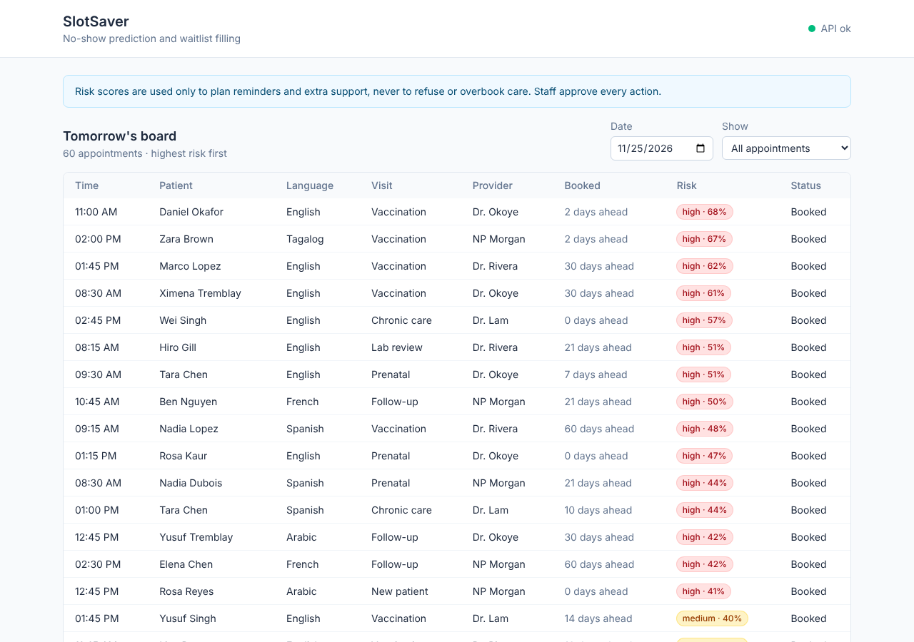

# SlotSaver

**AI-powered no-show prediction and waitlist filling for community clinics.**

SlotSaver helps clinic front-desk staff see which of tomorrow's appointments are likely to be missed, and explains why in plain words. For high-risk slots it drafts a reminder in the patient's own language and suggests a waitlist patient who could take a freed slot. Staff approve every action, and the risk score is used only to plan reminders, never to refuse or overbook care.

> AML 3303 Capstone, Fall 2026 · Team LazLearness · Theme 1: Healthcare access

## Demo



3-minute demo video: _link added before Dec 9_

## Team

| Member | Role |
| --- | --- |
| Dev | Team lead and integration (repo, CI, README, workflow diagram) |
| Mahir | Frontend (React screens, approval flow, AI assistant chat UI) |
| Jatin | Backend and database (API, schema, scheduler, Slack) + RAG pipeline |
| Amal | Data and ML (cleaning, model, evaluation, SHAP) |
| Pratik | LLM agent (prompts, tools, reminder drafting, agent evaluation) |

## Workflow diagram

_Full system diagram (user → frontend → API → database / ML model / LLM agent → tools → staff approval, plus the training flow) goes in `docs/workflow.png`. Owner: Dev._

## How to run

**Prerequisites:** Python 3.11+, Node.js 20+, Git. Docker is optional (only for PostgreSQL).

### 1. Clone and set up Python

```bash
git clone <repo-url> slotsaver
cd slotsaver
python -m venv .venv
# macOS / Linux:
source .venv/bin/activate
# Windows (PowerShell):
.venv\Scripts\Activate.ps1
pip install -r requirements.txt
```

### 2. Create your `.env`

```bash
# macOS / Linux
cp .env.example .env
# Windows
copy .env.example .env
```

Choose a database in `.env`:

- **PostgreSQL (default):** run `docker compose up -d` and keep the default `DATABASE_URL`.
- **No Docker:** change the line to `DATABASE_URL=sqlite:///./slotsaver.db`.

### 3. Load demo data and start the API

```bash
python -m backend.app.seed --demo-scores
uvicorn backend.app.main:app --reload
```

The API runs at http://localhost:8000. Interactive docs: http://localhost:8000/docs. Health check: http://localhost:8000/health.

`--demo-scores` adds **placeholder** random risk scores (model version `placeholder-v0`) so the UI can be built before the real model is connected. Run without it to load unscored data.

### 4. Start the frontend (second terminal)

```bash
cd frontend
cp .env.example .env      # Windows: copy .env.example .env
npm install
npm run dev
```

Open http://localhost:5173.

### 5. Run the tests

```bash
pytest -v
ruff check .
```

## API (so far)

| Method and path | Purpose |
| --- | --- |
| `GET /health` | API, database and model status (503 if the database is down) |
| `GET /appointments?date=YYYY-MM-DD&min_risk=0.4` | A day's appointments, highest risk first (defaults to tomorrow) |
| `GET /appointments/{id}` | One appointment with patient language, lead time and risk reasons |

All errors return `{"error": "...", "detail": ...}` and are logged to `logs/app.log`.

## Project structure

```
backend/app/     FastAPI app: main.py, models.py, schemas.py, routers/, seed.py
frontend/        React + Vite + Tailwind
ml/              Training, evaluation, notebooks, saved model (Amal)
prompts/         Every LLM prompt as its own file, versioned (Pratik)
eval/            Agent test questions and runner (Pratik)
data/            Download and synthetic-data scripts, policy docs for RAG
tests/           pytest tests (run in GitHub Actions)
docs/            Workflow diagram and screenshots
```

## Data

_To be completed by Amal:_ Kaggle "Medical Appointment No Shows" (public, about 110,000 rows) for training; synthetic patients, waitlist and policy documents for the app. No real personal data. Cleaning steps in two or three lines.

## Evaluation

_To be completed:_ model results table (baseline vs. XGBoost, train vs. test), chosen threshold and why, confusion matrix and error analysis; agent test results (18 questions: answer accuracy, tool-choice accuracy, two worst failures and fixes).

## Explainability

_To be completed:_ SHAP summary and three plain-word example predictions; how the UI shows sources, the tool the agent used and why; where explanations could mislead.

## AI components

_To be completed by Pratik and Jatin:_ LLM and provider, list of prompt files, table of agent tools (name and one-line purpose).

## Known limits and next steps

- Risk scores in the current build are placeholders until the trained model is served.
- **Risk:** the model may flag disadvantaged patients more often. **Mitigation:** the score only triggers extra support, there is no overbooking feature, staff approve every action, and we report results by patient group.

## Credits

FastAPI, SQLAlchemy, Pydantic, React, Vite, Tailwind CSS. Dataset: Kaggle "Medical Appointment No Shows". AI tools used are listed in [AI_USE.md](AI_USE.md).
